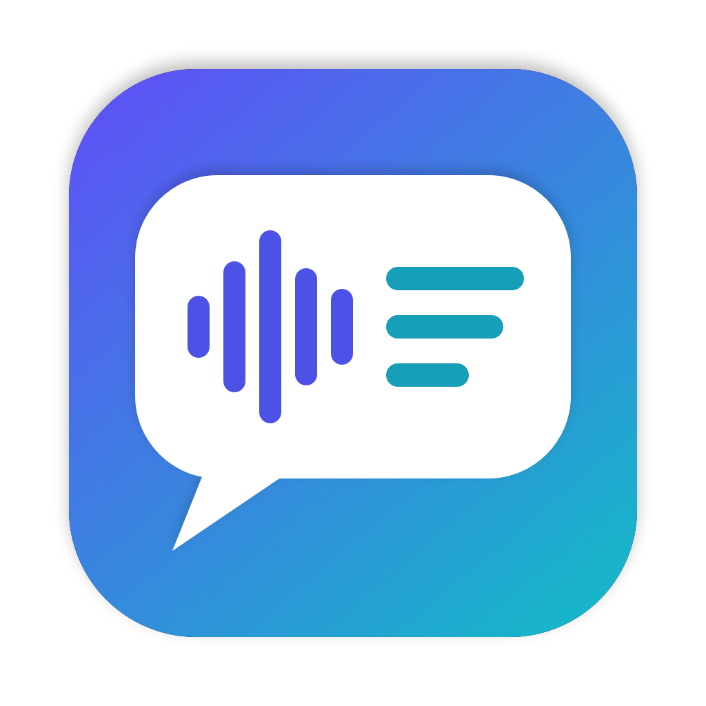

# MacPTTT — Mac Push Talk to Text

**English** · [ภาษาไทย](README.th.md)

Push-to-talk dictation for the macOS menu bar, in Thai and English. Hold a key and speak: the text is typed at the cursor as you talk, in whatever app you are using. It uses Apple's built-in Speech framework (`SFSpeechRecognizer`) **on-device only**, so it works offline and no audio leaves your Mac. No start/stop sounds.

## Features
- **Push-to-talk** with a key you choose: Left Option by default, or any left- or right-hand modifier
- **Types while you speak**, word by word, and corrects the tail to the final result when you release the key
- **Punctuation**: automatic, plus spoken commands ("comma", "new line", Thai "ย่อหน้าใหม่", "ไม้ยมก", …)
- **Automatic language selection** between Thai and English, or a fixed language
- **Offline**: on-device speech models only, never Apple's servers
- **Live waveform** of the microphone at the bottom-center of the screen while you speak
- **Launches at login**

## Install
1. Download **MacPTTT-x.y.dmg** from [Releases](https://github.com/matee-w/MacPTTT/releases/latest), open it and drag **MacPTTT** to Applications.
2. The app is not notarized by Apple, so macOS blocks the first launch. Open **System Settings → Privacy & Security** and click **Open Anyway**, or run:
   ```bash
   xattr -dr com.apple.quarantine /Applications/MacPTTT.app
   ```
3. Grant permissions (see below).

Requires macOS 13 or later. Universal app (Apple Silicon and Intel).

## Permissions
1. **Microphone** and **Speech Recognition**: click Allow when asked.
2. **Accessibility**: System Settings → Privacy & Security → Accessibility → turn on MacPTTT. This lets the app listen for the push-to-talk key in other apps and type or paste the text.
3. **Quit and reopen MacPTTT** after granting Accessibility. The global key monitor only starts at launch.

The second line of the menu shows the current state, e.g. `Offline · Mic ✓ · Speech ✓ · Accessibility ✓`.

## Usage
Hold the push-to-talk key → speak (words appear at the cursor about half a second after you say them) → release.

If you press another key while holding the push-to-talk key in the first second (e.g. ⌥← or ⌘C), MacPTTT treats it as a shortcut and cancels, so modifier shortcuts keep working.

Menu bar icon (a speech bubble turning sound into text): outline = ready · filled = listening · ⋯ = processing · ! = unavailable (missing permission or on-device model)

## Menu
- **Push-to-Talk Key**
  - Left hand: **Left Option** (default), Left Control, Left Command, Left Shift, Fn (Globe)
  - Right hand: Right Option, Right Command, Right Control, Right Shift

  If you use Fn, set System Settings → Keyboard → "Press 🌐 key to" to "Do Nothing".
- **Language**
  - **Automatic (Thai / English)**: transcribes live in the language detected last time. If its confidence is below 0.6, the recorded audio is transcribed again in the other language and the result with higher confidence wins. On-device Speech cannot run two languages at the same time, so this is done one after the other; switching languages adds a short delay.
  - **Thai** / **English (US)**: always use one language.
- **Punctuation**
  - **Automatic Punctuation**: macOS adds punctuation (mostly for English).
  - **Thai Voice Commands**: converts spoken Thai commands to symbols (see below).
  - **Show Voice Commands…**: the list in a window.
- **Type While Speaking** (on by default): types words that the recognizer has stopped revising, plus the last word after a short pause, and fixes short changes at the end as you go. When you release the key it compares with the final result and fixes only the part that differs. Turn it off to paste everything at once on release (via the clipboard).
- **Launch at Login** (on by default when installed in /Applications).

## Voice commands
**English** is handled by macOS: say "comma", "period", "question mark", "exclamation point", "colon", "semicolon", "open/close parenthesis", "new line", "new paragraph".

**Thai** (say the word while dictating):

| Say | Inserts |
|---|---|
| เครื่องหมายคำถาม | ? |
| เครื่องหมายตกใจ | ! |
| เครื่องหมายจุด / มหัพภาค | . |
| เครื่องหมายคำพูดเปิด / เครื่องหมายคำพูดปิด | “ ” |
| ย่อหน้าใหม่ | new line |
| ไปยาลน้อย | ฯ |
| วงเล็บเปิด / วงเล็บปิด | ( ) |
| ไม้ยมก | ๆ |
| จุลภาค | , |
| เว้นวรรค | space |

macOS already converts "เครื่องหมายคำถาม", "เครื่องหมายตกใจ" and "วงเล็บเปิด/ปิด" itself.

## Offline (on-device models)
MacPTTT only uses the speech models stored on the Mac. It never falls back to Apple's servers, so it works without internet. If a language has no on-device model, the menu shows **⚠︎ No on-device model for …**. Click it and add the language under **Keyboard → Dictation** so macOS downloads the model.

## Build from source
Needs Xcode or the Command Line Tools (`xcode-select --install`).

```bash
./build.sh             # build MacPTTT.app for this Mac
./build.sh --install   # build, install to /Applications and launch
./build.sh --dist      # universal build + dist/MacPTTT-<version>.dmg
swift Tools/make-icon.swift   # regenerate Resources/AppIcon.icns
```

> The app is ad-hoc signed, so macOS treats every rebuild as a new app. Remove MacPTTT from the Accessibility list and add it again after each rebuild.

## Configuration (`Sources/main.swift` → `Config`)
- `autoAcceptConfidence`: confidence at which Automatic mode accepts the first language without trying the other
- `finalResultTimeout`: how long to wait for the final result after releasing the key
- `overlayDelay`: how long the key must be held before the waveform appears

## License
[MIT](LICENSE)
