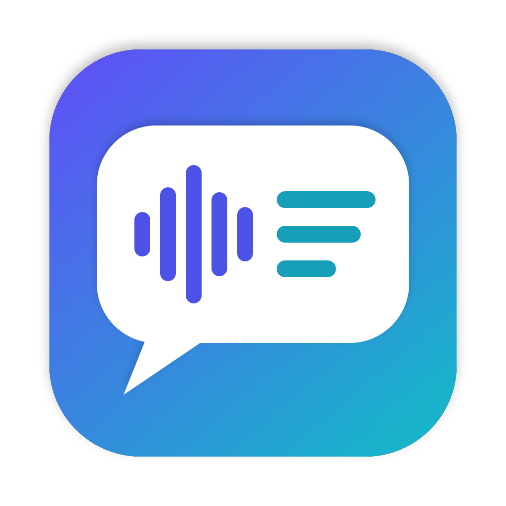

# MacPTTT — Mac Push Talk to Text

[English](README.md) · **ภาษาไทย**

Push-to-talk dictation บน menu bar ของ macOS รองรับภาษาไทยและอังกฤษ กดปุ่มค้างแล้วพูด ข้อความจะถูกพิมพ์ที่เคอร์เซอร์ในแอปที่ใช้อยู่ไปพร้อมกับที่พูด ใช้ Speech framework (`SFSpeechRecognizer`) ที่มากับระบบ **แบบบนเครื่องเท่านั้น** จึงใช้ได้โดยไม่ต้องต่อเน็ต และเสียงไม่ถูกส่งออกไปนอกเครื่อง ไม่มีเสียง feedback ตอนเริ่มหรือจบ

## ความสามารถ
- **Push-to-talk** ค่าเริ่มต้นคือ Option ซ้าย หรือเลือกปุ่ม modifier ฝั่งซ้ายหรือขวาก็ได้
- **พิมพ์ขณะพูด** ทีละคำ แล้วแก้ส่วนท้ายให้ตรงกับผลสุดท้ายเมื่อปล่อยปุ่ม
- **เครื่องหมายวรรคตอน** ใส่อัตโนมัติ และสั่งด้วยเสียงได้ เช่น "ย่อหน้าใหม่", "ไม้ยมก", "comma"
- **เลือกภาษาอัตโนมัติ** ระหว่างไทยกับอังกฤษ หรือบังคับภาษาเดียว
- **Offline** ใช้เฉพาะโมเดลบนเครื่อง ไม่ใช้เซิร์ฟเวอร์ของ Apple
- **คลื่นเสียง** จากไมค์ขึ้นด้านล่างกลางจอขณะพูด
- **เปิดอัตโนมัติเมื่อ login**

## ติดตั้ง
1. ดาวน์โหลด **MacPTTT-x.y.dmg** จาก [Releases](https://github.com/matee-w/MacPTTT/releases/latest) เปิดไฟล์แล้วลาก **MacPTTT** ไปที่ Applications
2. แอปไม่ได้ notarize กับ Apple เปิดครั้งแรก macOS จะบล็อก ให้ไปที่ **System Settings → Privacy & Security** แล้วกด **Open Anyway** หรือรันคำสั่ง:
   ```bash
   xattr -dr com.apple.quarantine /Applications/MacPTTT.app
   ```
3. ให้สิทธิ์ตามหัวข้อถัดไป

ต้องใช้ macOS 13 ขึ้นไป รองรับทั้ง Apple Silicon และ Intel

## สิทธิ์ที่ต้องให้ (ครั้งแรก)
1. **Microphone** และ **Speech Recognition** — จะมี dialog ถาม ให้กด Allow
2. **Accessibility** — System Settings → Privacy & Security → Accessibility → เปิด MacPTTT (ใช้ฟังปุ่มขณะอยู่ในแอปอื่น และพิมพ์หรือวางข้อความ)
3. **ปิดแล้วเปิดแอปใหม่** หลังให้ Accessibility เพราะตัวดักปุ่มเริ่มทำงานตอนเปิดแอปเท่านั้น

บรรทัดที่สองในเมนูบอกสถานะ เช่น `Offline · Mic ✓ · Speech ✓ · Accessibility ✓`

## ใช้งาน
กดปุ่ม push-to-talk ค้างไว้ → พูด (คำจะขึ้นที่เคอร์เซอร์หลังพูดราวครึ่งวินาที) → ปล่อย

ถ้ากดปุ่มอื่นร่วมภายในวินาทีแรก เช่น ⌥← หรือ ⌘C แอปจะถือว่าเป็นคีย์ลัดและยกเลิกการฟัง คีย์ลัดเดิมจึงยังใช้ได้ตามปกติ

ไอคอนบน menu bar (ฟองคำพูดที่เปลี่ยนเสียงเป็นข้อความ): ฟองโปร่ง = พร้อม · ฟองทึบ = กำลังฟัง · ⋯ = กำลังประมวลผล · ! = ใช้ไม่ได้ (ขาดสิทธิ์หรือไม่มีโมเดลบนเครื่อง)

## เมนู
- **Push-to-Talk Key**
  - มือซ้าย: **Left Option** (ค่าเริ่มต้น), Left Control, Left Command, Left Shift, Fn (Globe)
  - มือขวา: Right Option, Right Command, Right Control, Right Shift

  ถ้าใช้ Fn ให้ตั้ง System Settings → Keyboard → "Press 🌐 key to" เป็น "Do Nothing"
- **Language**
  - **Automatic (Thai / English)** — ถอดสดด้วยภาษาที่ตรวจพบล่าสุด ถ้า confidence < 0.6 จะถอดเสียงเดิมซ้ำด้วยอีกภาษาแล้วเลือกผลที่ confidence สูงกว่า
    (Speech บนเครื่องรันสองภาษาพร้อมกันไม่ได้ จึงต้องทำทีละรอบ เมื่อสลับภาษาจะช้าขึ้นเล็กน้อย)
  - **Thai** / **English (US)** — บังคับภาษาเดียว
- **Punctuation**
  - **Automatic Punctuation** — ให้ macOS เติมเครื่องหมายเอง (ได้ผลกับภาษาอังกฤษเป็นหลัก)
  - **Thai Voice Commands** — แปลงคำสั่งเสียงภาษาไทยเป็นสัญลักษณ์ (ดูตารางด้านล่าง)
  - **Show Voice Commands…** — แสดงรายการคำสั่งในหน้าต่าง
- **Type While Speaking** (เปิดเป็นค่าเริ่มต้น) — พิมพ์คำที่ระบบถอดความไม่แก้แล้ว พิมพ์คำสุดท้ายเมื่อหยุดพูดครู่หนึ่ง และแก้ส่วนท้ายสั้นๆ ระหว่างพูด ตอนปล่อยปุ่มจะเทียบกับผลสุดท้ายแล้วแก้เฉพาะส่วนที่ต่าง ถ้าปิด จะวางข้อความทั้งหมดทีเดียวตอนปล่อยปุ่ม (ผ่าน clipboard)
- **Launch at Login** — เปิดเป็นค่าเริ่มต้นเมื่อติดตั้งใน /Applications

## คำสั่งเสียง
**ภาษาอังกฤษ** macOS แปลงให้เอง: พูด "comma", "period", "question mark", "exclamation point", "colon", "semicolon", "open/close parenthesis", "new line", "new paragraph"

**ภาษาไทย** (พูดคำสั่งระหว่างพูดข้อความ):

| พูด | ได้ |
|---|---|
| เครื่องหมายคำถาม | ? |
| เครื่องหมายตกใจ | ! |
| เครื่องหมายจุด / มหัพภาค | . |
| เครื่องหมายคำพูดเปิด / เครื่องหมายคำพูดปิด | “ ” |
| ย่อหน้าใหม่ | ขึ้นบรรทัดใหม่ |
| ไปยาลน้อย | ฯ |
| วงเล็บเปิด / วงเล็บปิด | ( ) |
| ไม้ยมก | ๆ |
| จุลภาค | , |
| เว้นวรรค | ช่องว่าง |

macOS แปลง "เครื่องหมายคำถาม", "เครื่องหมายตกใจ" และ "วงเล็บเปิด/ปิด" ให้เองอยู่แล้ว

## Offline (โมเดลบนเครื่อง)
MacPTTT ใช้เฉพาะโมเดลเสียงที่อยู่ในเครื่อง ไม่ส่งเสียงไปเซิร์ฟเวอร์ของ Apple จึงใช้ได้โดยไม่ต้องต่อเน็ต ถ้าภาษาไหนไม่มีโมเดลบนเครื่อง เมนูจะขึ้น **⚠︎ No on-device model for …** ให้กดเมนูนั้นแล้วเพิ่มภาษาใน **Keyboard → Dictation** เพื่อให้ macOS ดาวน์โหลดโมเดล

## Build จากซอร์สโค้ด
ต้องมี Xcode หรือ Command Line Tools (`xcode-select --install`)

```bash
./build.sh             # build MacPTTT.app สำหรับเครื่องนี้
./build.sh --install   # build + ติดตั้งลง /Applications + เปิดแอป
./build.sh --dist      # build universal + สร้าง dist/MacPTTT-<version>.dmg
swift Tools/make-icon.swift   # สร้าง Resources/AppIcon.icns ใหม่
```

> แอปเซ็นแบบ ad-hoc ทุกครั้งที่ build ใหม่ macOS จะมองเป็นแอปใหม่ ต้องลบ MacPTTT ออกจากรายการ Accessibility แล้วเพิ่มใหม่

## ปรับแต่ง (`Sources/main.swift` → `Config`)
- `autoAcceptConfidence` — เกณฑ์ที่โหมด Automatic ยอมรับภาษาแรกโดยไม่ลองภาษาอื่น
- `finalResultTimeout` — เวลารอผลสุดท้ายหลังปล่อยปุ่ม
- `overlayDelay` — ต้องกดค้างนานเท่าไรก่อนคลื่นเสียงจะขึ้น

## License
[MIT](LICENSE)
